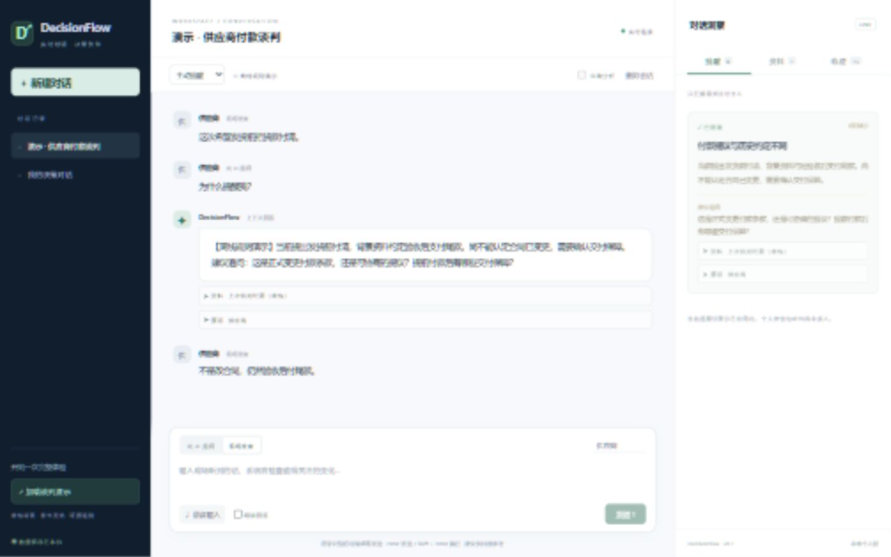
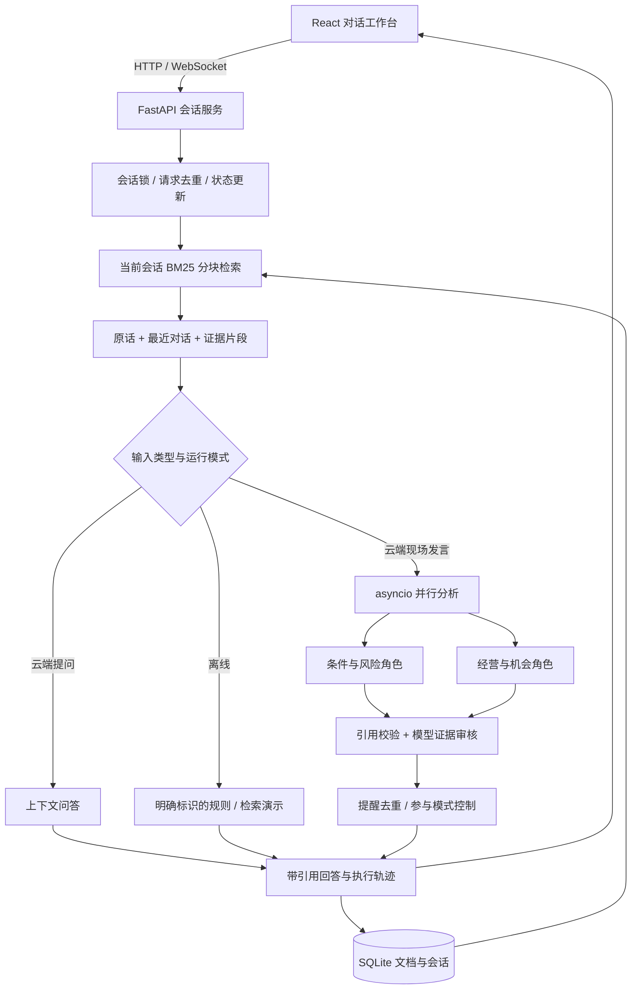

# DecisionFlow RAG

### 基于 FastAPI、React 与 BM25 的多 Agent 对话决策助手

[](https://github.com/sbzz666/decisionflow-rag/actions/workflows/ci.yml)


**从对话中发现变化，用资料解释依据，让每一次提醒都可以追溯。**

DecisionFlow RAG 面向谈判、会议与经营沟通，将现场发言、背景资料检索、并行分析、证据审核和后续追问组织成一个可观察的工作流。项目重点是让决策辅助具备可检查的依据：提醒来自哪段原话、参考了哪条约定、是否已经被后续澄清。

> **当前版本 v0.2**：可本地运行的个人原型。BM25 检索、会话管理、规则演示及前后端链路可直接体验；LLM 调用与角色编排已实现，通过模拟响应测试，尚未配置真实模型密钥或评测真实模型效果。

[快速体验](#快速体验) · [技术栈](#技术栈) · [系统架构](#系统架构) · [工程设计](#工程设计) · [实现边界](#实现边界)

## 一个具体场景

背景资料写着“预付 30%，验收后支付 70% 尾款”。谈判中，对方提出“发货前把货款付清”。

| 阶段 | 系统行为 |
| --- | --- |
| 接收现场发言 | 保存发言人与原话，更新会话版本 |
| 检索历史约定 | 从当前会话资料中找到相关付款条款 |
| 产生候选提醒 | 对比付款提议与背景，指出需要确认的变化 |
| 展示依据 | 展开原文片段、来源名称与字符位置 |
| 继续追问 | 围绕当前问题、资料与已有提醒回答 |
| 明确澄清 | 对预设付款澄清表达，将旧提醒标为已澄清 |

这一场景提供无密钥的规则演示。任意业务场景的语义理解与分析需要配置模型，不能从演示结果推断真实模型准确率。



*截图为 v0.1 规则演示；v0.2 已更新 RAG 名称与片段引用展示。*

## 技术栈

| 层次 | 技术 | 在项目中承担的职责 |
| --- | --- | --- |
| 前端 | React 19、TypeScript、Vite 6 | 对话工作台、资料管理、提醒卡片、可展开引用和执行轨迹 |
| API 与通信 | Python、FastAPI、WebSocket | 会话 API、双向状态通信、处理状态通知 |
| 数据契约 | Pydantic | 校验用户输入与模型候选输出的结构 |
| 任务编排 | asyncio.gather、固定角色提示词 | 并行调用风险与机会分析，再对候选结论逐条审核 |
| RAG | 文档分块、中文双字词、BM25 | 检索会话资料，为问答和分析提供有界证据上下文 |
| 持久化 | SQLite | 保存会话、文档、分块、提醒及轨迹 |
| 模型适配 | HTTPX、Chat Completions 兼容接口 | 服务端配置模型地址、名称与密钥，解析 JSON 结果 |
| 语音交互 | 浏览器 SpeechRecognition / SpeechSynthesis | 识别后编辑发送、可选朗读；依赖浏览器支持 |
| 质量保障 | pytest、Mock、TypeScript 检查、GitHub Actions | 后端回归测试与前端生产构建 |

**技术选择**：当前使用 BM25，不依赖向量模型或向量数据库；使用显式 asyncio 工作流，不依赖 LangGraph。这样可以先验证证据流、状态流和调用边界，再根据召回质量与延迟测量决定是否增加组件。

## 系统架构



这里的 Multi-Agent 指 **两个分析角色与一个审核角色组成的固定 LLM 工作流**，另有问答路径。各角色共享检索结果，职责和输出契约不同；当前不包含自主规划、动态工具选择或完整冲突仲裁。

## 工程设计

### 1. 让回答引用具体证据

资料按最多 500 字符分块，保留 80 字符重叠，并优先在句末切分。每个片段携带文档 ID、内容哈希、字符起止位置。BM25 选取最多 5 个片段，总文本预算为 2200 字符，供多个角色共用。模型返回的引用必须存在于本次上下文中，候选提醒还需经过模型审核。

### 2. 将模型输出与提醒发送分开

分析角色只产生结构化候选结果。工作流负责校验引用、审核证据、抑制重复，以及执行“主动提醒 / 征询后展开 / 仅记录”模式。审核调用失败时，不发布未经审核的模型候选。

### 3. 管理对话状态与数据生命周期

每个会话通过异步锁串行处理，请求 ID 防止重复提交。资料、片段与结果关联保存；删除资料会同步清理直接引用它的提醒和回答。付款澄清规则能更新已发布提醒状态。检索限定当前会话，避免混用其他会话的资料。

### 4. 让失败与离线状态可见

模型调用失败、输出校验失败、引用被拒绝都会记录执行轨迹。无密钥时明确显示离线规则演示；问答调用失败时回退到标记清楚的检索或规则回答。轨迹用于观察执行步骤，不展示或声称获取模型内部思维过程。

## 快速体验

先按下节安装，再打开 http://127.0.0.1:8765 。Windows 也可使用 `start.cmd` / `start.ps1` 启动。

1. 点击“加载谈判演示”，创建带虚构付款约定的会话。
2. 发送“这次希望发货前把货款付清。”，观察提醒与引用。
3. 切换“向 AI 提问”，输入“为什么提醒我？”。
4. 切回“现场发言”，发送“不是改合同，仍然验收后付尾款。”。
5. 检查旧提醒的澄清状态，以及右侧检索和审核执行轨迹。

无需密钥可体验规则路径；接通模型后才能验证通用对话和语义分析。

## 安装与运行

需要 Python 3.11+、Node.js 20.19+ 和 npm。

```powershell
python -m venv .venv
.\.venv\Scripts\python.exe -m pip install -r requirements.txt
cd frontend
npm.cmd ci
npm.cmd run build
cd ..
.\.venv\Scripts\python.exe -m uvicorn app.main:app --host 127.0.0.1 --port 8765
```

如 Python 发行版无法初始化 pip，可用 `uv venv .venv` 和 `uv pip install --python .venv/Scripts/python.exe -r requirements.txt`。

Linux / macOS 可用以下命令（Windows 使用上面的命令）：

```bash
python3 -m venv .venv
.venv/bin/python -m pip install -r requirements.txt
(cd frontend && npm ci && npm run build)
.venv/bin/python -m uvicorn app.main:app --host 127.0.0.1 --port 8765
```

## 接入真实模型

密钥只配置在本机服务端，不放入浏览器或代码。`.env.example` 供参考，程序不会自动读取 `.env`。

```powershell
$env:DECISIONFLOW_API_KEY="你的密钥"
$env:DECISIONFLOW_BASE_URL="https://api.deepseek.com"
$env:DECISIONFLOW_MODEL="deepseek-chat"
.\start.ps1
```

随后在页面开启“云端分析”。相关原话和检索资料将发送至配置的供应商。模型路径实际执行两个并行分析角色、证据复核和参与策略；尚未用真实密钥验证效果。

## 验证与持续集成

GitHub Actions 在 push / pull request 时分别执行 Python 3.12 后端测试与 Node.js 22 前端构建。首个上传版本的远端检查已通过；当前提交状态可点击顶部徽章查看。

| 验证范围 | 已覆盖内容 |
| --- | --- |
| 后端：14 项测试 | 会话隔离、请求去重、参与模式、澄清、持久化、WebSocket 与非法输入 |
| RAG | 分块覆盖与偏移、内容变更 ID、上下文预算、无命中、引用持久化与删除清理 |
| 模型接口（Mock） | 并行分析衔接、证据审核、伪造引用拒绝、异常回退 |
| 前端 | TypeScript 类型检查与 Vite 生产构建 |

```bash
python -m pytest -q
cd frontend
npm ci
npm run build
```

激活虚拟环境后运行上述命令。Windows 如遇临时目录权限问题，可用 `python -m pytest -q --basetemp .test-runs/local-check`。

## 代码导航

```text
app/
  main.py       API、WebSocket、会话锁与输入校验
  rag.py        分块、BM25、片段元数据与检索预算
  engine.py     角色编排、问答、候选审核与提醒控制
  store.py      SQLite 会话持久化
frontend/src/   React 工作台与样式
tests/          API、工作流与 RAG 回归测试
research/       虚构回放场景及标注
docs/           实现记录、设计分析与评估方案
.github/        自动测试与构建工作流
```

建议阅读顺序：`rag.py` → `engine.py` → `main.py` → `tests/test_rag.py`，沿“证据怎么找、结论怎么产出、状态怎么保存、行为怎么验证”理解系统。

## 实现边界

- **模型效果**：真实模型未配置、未评测；测试使用模拟响应。不报告准确率、延迟优化或生产吞吐成绩。
- **检索**：当前为词项 BM25，没有 Embedding、向量召回、神经重排序、文件解析或 OCR；同义改写可能漏召回。
- **Agent**：固定角色工作流，尚无通用矛盾仲裁、动态任务规划、旧分析中断或 token 流式输出。
- **产品**：本地单用户原型，无多租户权限、跨会话自动记忆、个人微信或邮件通知。语音识别需编辑后发送。
- **数据**：密钥只在服务端环境变量中配置；本地数据库、`.env`、缓存不提交。云端模式会将相关对话与证据发送至配置的供应商。资料被作为不可信输入处理，但提示词不能保证完全防止注入。

## 文档与后续评估

- [RAG 设计与边界](docs/rag.md) / [当前实现与验证记录](docs/implementation-status.md)
- [公开产品行为研究](docs/evidence.md)：区分公开资料、视频观察与架构推断。
- [候选架构](docs/architecture.md) / [算法方案](docs/algorithm-spec.md) / [提示词契约](docs/prompt-contracts.md)：研究设计，部分尚未实现。
- [评估计划](docs/evaluation.md) / [虚构回放样例](research/fixtures/README.md)：后续用于比较单角色与多角色、检索召回和提醒质量。
- [更新记录](CHANGELOG.md)

下一步以可复现评测推进：接入真实模型后，测量证据召回、引用正确性、提醒误报与端到端延迟；根据结果决定是否引入向量混合检索和冲突仲裁。项目受公开 AI 决策产品演示启发，不声称掌握或复现任何厂商的内部算法。
