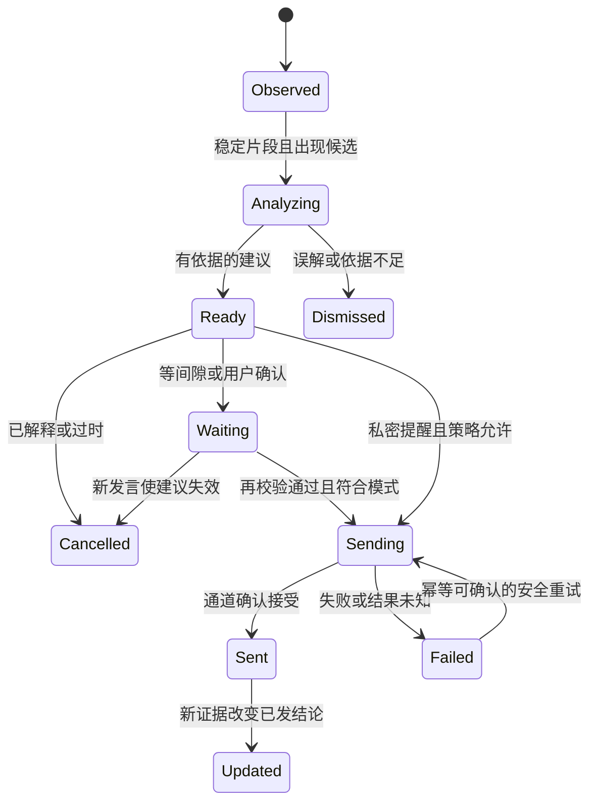

# 算法说明：从对话到介入

研究候选 v0.2；未实现、未实测。本文所有结构、提示词和规则为 DecisionFlow 原创设计，并非原厂披露。

## 视频复核记录

复核素材为 video-analysis/detail-02.jpg 与 detail-03.jpg。拼图显示的是裁切片段的相对时间，须加上片段起点 02:10。例如 detail-02 的 00:54 对应原视频约 03:04，01:00 对应 03:10；detail-03 的 01:27 对应约 03:37。

在这些帧中可见：讲述多模型与豆包；讲述内部多 Agent 架构；手机提醒与公司内部信息有关，并从公关、投融资角度分析。注意“多 Agent”是讲述者的声明，画面并未展示实际调用日志。

不能由此推断：存在三个独立专家、使用某个框架、实际并行执行、每句话都调用模型、采用声学情绪模型。对话中的角色视角可能由一次生成完成。

## 需要比较的三种实现假设

| 假设 | 怎样解释演示 | 优势 | 可检验的问题 |
|---|---|---|---|
| H1 单模型全上下文 | 预装企业背景，持续或定时让模型判断是否发言 | 简单，少一次协调调用 | 随会议增长是否丢失约束，是否频繁误报 |
| H2 固定流水线 | 提取事件、检索、分析、复核分阶段调用 | 调用过程明确 | 是否每个事件都承担不必要延迟 |
| H3 动态协作 | 协调器按问题选择分析角色，汇总后控制发言 | 可按需分析 | 路由收益能否覆盖其成本和新故障 |

三种都能产生类似视频行为。因此先实现复杂架构并不能证明“还原了原厂”。验证目标是找到稳定复现行为且可解释的最小机制。

## 事件检测契约

输入是增量稳定发言、当前议题、相关约束摘要与未决事件。输出可以为空，不能被要求“必须找出风险”。

每个候选至少含：事件类型、原话引用、涉及对象、变化前/后、是否假设、缺失信息、与未决事件的关系。禁止仅凭语气断定对方撒谎或动机。

建议类型：condition_change、contradiction、unsupported_assumption、commitment、opportunity、explicit_question。它们是分类标签，不是结论。

## 检索契约

查询使用对象、议题、条件和有效时间，不只是最后一句话。先限制会话/资料权限，再检索；源资料包含的命令不成为工具指令。返回片段、来源、版本、有效期和敏感度。无命中则保留缺背景状态。

## 分析契约

输出固定区分 observations、assumptions、possible_impacts、options、questions、evidence_ids。建议优先可执行的追问，不在材料不足时给确定性的经营结论。需要计算时保留单位、算式和前提。

多个角色冲突时由协调器保留分歧与依赖条件，不能以票数产生事实。复核可要求缩小表述或拒绝输出，并不自动再发起无限轮讨论。

## 介入状态机

通道接受不等于用户阅读。通道不支持幂等、结果又未知时，不直接无限重试；记录未知状态。已发送的错误结论用更正处理，不能假装撤回了用户已经看到的内容。

## 硬规则与模型判断分工

| 事项 | 责任 |
|---|---|
| 收件人、参与模式、权限、事件唯一编号 | 程序配置与状态管理 |
| 是否出现语义冲突、可能影响 | 模型辅助并附证据 |
| 引用是否存在、字段/单位格式 | 程序校验 |
| 引用是否支持结论 | 语义复核与人工评估 |
| 是否已解决、是否存在新条件 | 最新状态比对，必要时模型复核 |
| 是否重复 | 实体/条件事件键加语义归并，不能只比较文字 |

## 调度边界

后台分析使用状态快照版本。新发言不会无条件取消所有任务，只让涉及变化的候选失效；显式问题有优先级。重任务按事件合并，避免音频越积越多。每个事件设置最大调用数和截止时间，具体参数待实验选择。

在只有文字回放的实验里不声称完成流式 ASR、声音降噪或真实打断；这些属于后续端到端验证。
