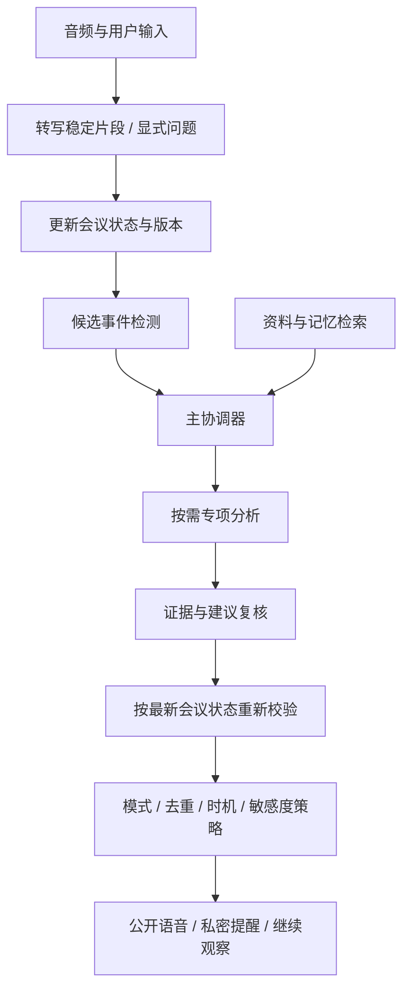

# 候选算法与 Agent 架构

状态：研究设计，未实现、未测量。本文角色名称与字段由 DecisionFlow 提出，不代表 NBBOSS 内部实现。

## 架构假设

采用持续输入、事件驱动的受控工作流。主协调器选择分析任务，显式策略负责模式、超时、去重与发送权限。无需每句话调用全部角色，也不默认自由辩论。

## 对话与分析分两条路径

显式提问优先进入对话路径：识别问题、检索必要背景、流式回答。被动监听进入事件路径：检测变化、分析候选事件、决定是否介入。两者共享状态，但主动提醒不能阻塞用户对话。

用户打断合成语音时立即停止播放，并取消或标记旧输出；避免把系统自己的扬声器声音重新识别为用户新发言。重连应携带事件编号以去重，不重新发出历史提醒。

## 状态模型

| 对象 | 关键字段 | 约束 |
|---|---|---|
| Utterance | id, speaker_id, start_ms, end_ms, text, revision, final | 临时转写可修订，身份未知用匿名编号 |
| MeetingState | session_id, version, topic, goals, claims, open_questions, mode | 更新可追溯到来源发言 |
| Evidence | source_id, span, observed_at, sensitivity | 引用原文与时间，不能只有模型摘要 |
| CandidateEvent | id, type, evidence_ids, state_version, urgency, expires_at | 类型如矛盾、条件变化、承诺、待核实假设 |
| Analysis | event_id, observations, assumptions, options, unknowns, evidence_ids | 区分事实和推断 |
| Notification | event_id, dedupe_key, channel, status, sent_at | 发送幂等，状态含取消和过时 |
| Memory | id, kind, content, source_ids, valid_from, superseded_by | 明确事实、偏好和推测的类别 |

## 主协调器与角色

- 主协调器：依据事件选择必要角色、上下文和工具，设定调用预算及截止时间；路由失败保留事件，不臆造结果。
- 专项分析：初期只定义职责接口。经营可行性、风险/矛盾、替代方案可作为独立调用进行对照实验；证据不足时输出待核实项。
- 复核：核查引用是否支持结论、金额单位是否正确、问题是否已被解决。不能把另一模型同意视为独立事实证明。
- 记忆写入：异步提取候选记忆，保留来源与时间；推断不能自动覆盖显式事实。
- 发送控制：确定性规则约束权限、模式、冷却与幂等；模型可提出敏感度与紧急度判断，不能自行改收件人或权限。

共享状态由协调器管理。分析角色读取带版本的快照并返回结构化结果，不直接改写会议事实或直接发送通知。框架尚未决定，可先用显式函数流程验证，确有持久化和暂停恢复需求再评估图框架。

## 介入算法

1. 临时转写只用于界面预览；默认用稳定片段触发事实提取，减少纠错带来的误报。
2. 使用最近发言、当前议题和未决事件检测新增变化。精确金额阈值可用规则，语义冲突由模型辅助。
3. 提取实体、时间与约束构造检索查询，返回有来源的资料。无相关资料时显式声明缺背景。
4. 按需分析候选事件，输出观察、可能影响、建议追问与未知条件。
5. 复核后按最新 state_version 检查：对方是否已解释、老板是否已纠正、条件是否变化。
6. 依据模式、严重程度、重复情况、敏感度和发言时机决定发送、征询、等待或放弃。
7. 记录发出与未发出的原因，支持回放诊断。

不提前编造评分权重。先以规则和结构化判断建立基线，再根据标注数据评估阈值。模型自报置信度不当作校准概率。

## 三种参与模式

| 模式 | 默认行为 |
|---|---|
| 仅记录 | 不主动公开发言或推送；用户主动提问仍可回答 |
| 征询后展开 | 先发简短征询，经用户回应再展开 |
| 主动提醒 | 符合策略可直接提醒；敏感内容走私密渠道 |

个人微信属于待验证输出适配器。分析实验先记录结构化通知，不把渠道故障计成算法未检测到。

## 记忆机制

工作记忆保存近期原文与滚动摘要；情节记忆保存会议和决策；事实记忆保存有来源的企业资料；偏好记忆保存显式选择。长对话摘要只帮助导航，关键引用仍回查原文。

检索候选结合主题、人物与有效时间过滤，验证关键词/向量混合检索是否优于基线。历史事实冲突时保留版本，不把两者混成一个摘要。删除源资料需清除派生记忆与向量索引。不能宣称这种机制等于个人模型训练。

## 失败与权限

转写不清晰先请求确认；检索失败不引用不存在资料；分析超时降级为有依据的简短提醒或暂不提醒；发送失败与分析失败分别记录。通知中最小化敏感内容。

录音和资料中的指令均是数据，不能改变工具权限、写入系统提示或触发任意外发。工具参数由服务端校验。后台分析取消、超时与队列背压必须显式处理。

## 替代解释与待证伪假设

- 主动插话可能由定时批量分析实现，而非每句事件检测；回放实验比较延迟与成本。
- 画像可能只来自用户填写的提示词，而非自动学习；分别对比显式资料与自动提取记忆。
- 多 Agent 可能只是固定提示词串行调用；比较单调用、固定流水线和动态路由，只有收益足够才保留复杂结构。
