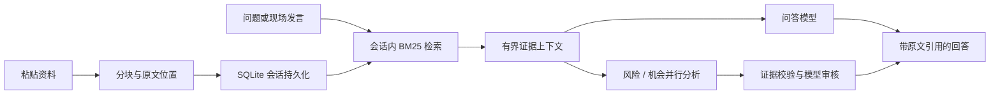

# DecisionFlow RAG · v0.2

项目全称：基于 FastAPI、React 与 BM25 的多 Agent 决策助手。

## 数据流

检索位于 `app/rag.py`，业务编排位于 `app/engine.py`。候选排序采用内存 BM25 实现，语料从当前会话资料构建；不是 SQLite FTS5 索引。BM25 公式参考 [SQLite 官方说明](https://www.sqlite.org/fts5.html#the_bm25_function)，本实现使用正向分数（越高越相关）。小规模会话上重建词频，避免额外服务；大规模语料应迁移倒排索引并评估性能。

片段 ID 包含文档 ID、内容哈希和字符偏移；原始切片不改写，前端可展开引用。内容哈希用于防止修改后误用旧 ID，不代表已实现版本历史。所有会话资料仍为本地单用户数据，没有多租户权限系统。

问答和分析调用使用同一模型配置，不新增模型密钥。没有密钥时仅展示检索资料；开启云端分析后，选中片段和最近对话发送至配置的模型供应商。检索本身不发送网络请求。

## 验证与限制

自动测试覆盖分块覆盖率、字符偏移、内容变更 ID、上下文预算、无命中、会话隔离、删除清理、模型输入片段、引用持久化及伪造引用拒绝。模型测试使用模拟响应，不是实际大模型效果评测。

不包含向量召回、Embedding、独立重排序、文件解析或 OCR。中文双字词召回仍可能错过同义表达；付款领域有少量显式查询扩展。没有对省略主语的问题做完整查询改写。多角色之间的冲突仲裁尚未实现。后续应用带标准证据的真实问题集评估 Recall@5、引用正确率、拒答质量与响应耗时，再决定是否引入混合检索。
